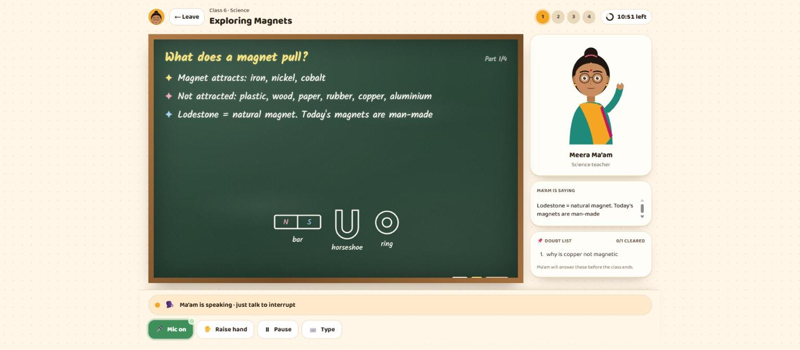
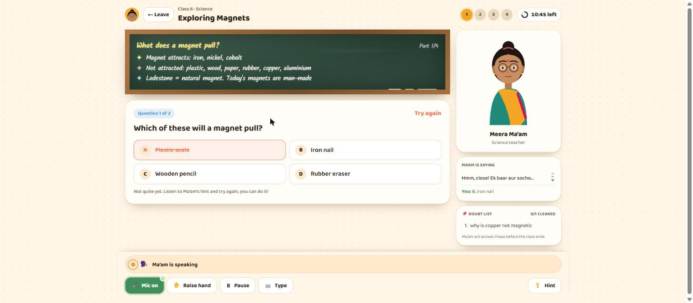
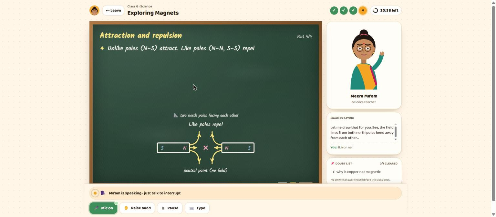
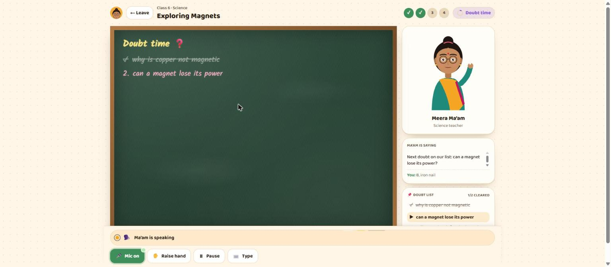
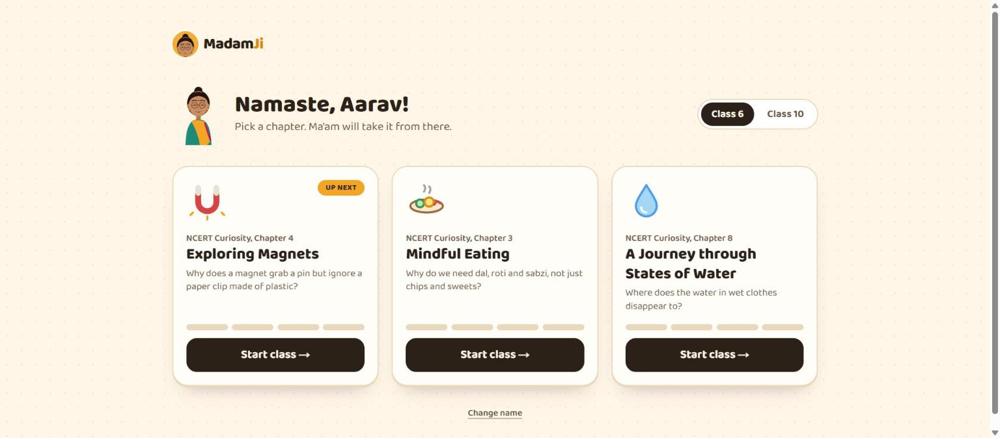
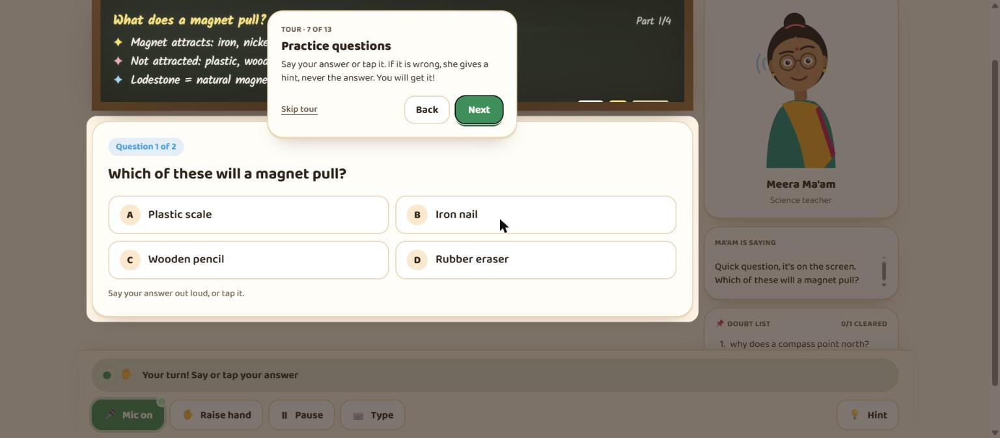
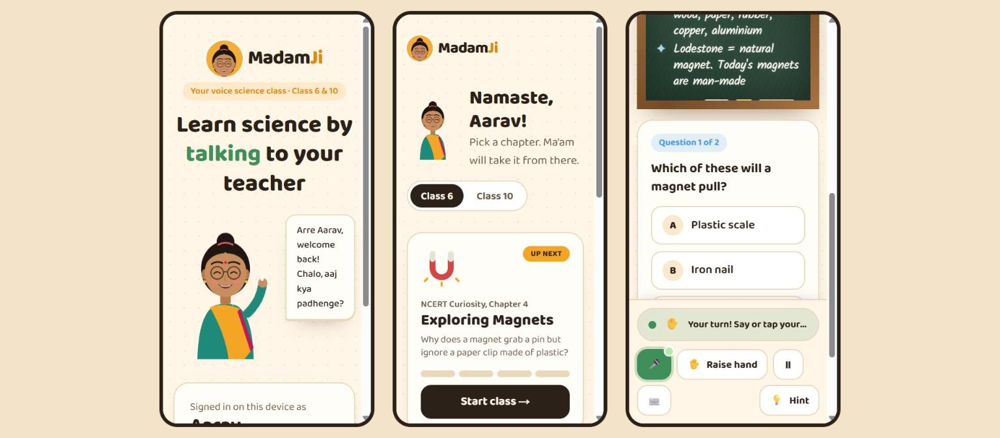
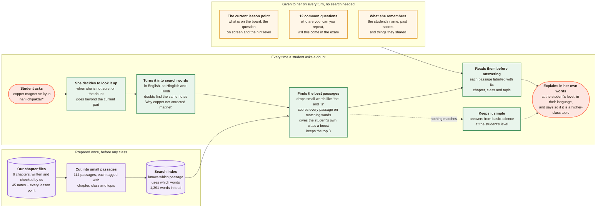

<p align="center">
  
</p>

<h1 align="center">MadamJi</h1>

<p align="center">
  <b>A voice science teacher for Indian school students. She leads the class, writes on the chalkboard,<br/>
  asks questions, clears doubts and never just hands you the answer.</b>
</p>

<p align="center">
  Science · Class 6 &amp; Class 10 · English, Hinglish and Hindi · Voice-first, works on phones
</p>

<!-- Live demo: <link> · Walkthrough video: <link> -->

<p align="center">
  
</p>

---

## What it is

Pick a chapter, choose a 15 or 25 minute class, and walk into a classroom. **Meera Ma'am** greets you
by name and teaches the chapter part by part, writing each point on a green chalkboard as she speaks.
After every part she checks for doubts and gives a practice question. You can talk to her any time,
even in the middle of her sentence, just like a real class.

**In class she:**

- **Leads the lesson herself.** The class runs from start to finish even if the student never speaks.
- **Teaches to your grade.** Short stories and everyday Indian examples for class 6. NCERT definitions,
  formulas and board-exam tips for class 10.
- **Asks practice questions and never gives the answer away.** MCQ, true/false, fill in the blank,
  numericals and short answers. A wrong answer earns a stronger hint each time (wrong options fade out,
  a blank gets its first letter, a numerical gets its formula set up) until you get it yourself.
- **Clears doubts like a teacher with a full class.** Two doubts per part are answered on the spot.
  More go on an on-screen doubt list, and she answers every one in doubt time before the class ends.
- **Draws when you ask.** "Can you explain it by drawing?" A diagram appears on the board while she talks.
- **Speaks your language.** She starts in English and follows you into Hinglish or Hindi. Captions
  are always in English letters.
- **Runs to time.** A class timer keeps her on track. If time runs out, she wraps up and the next class
  starts where you stopped.
- **Remembers you.** Your name, where you stopped, what you found tricky.
- **Handles real life like a person would.** Fees, exams, "are you a robot?", a maths question in
  science class, "book me a flight", hunger, anger, a fight with a friend, the same question asked
  three times.
- **Keeps children safe.** Talk of self-harm, abuse or hurting someone gets a calm, caring reply, the
  Tele MANAS helpline (14416), a paused lesson, and an alert with a sound ping on the staff dashboard.

| Practice that teaches | Drawing on request | Doubt time |
| --- | --- | --- |
|  |  |  |

| Pick a chapter | First-time tour | On a phone |
| --- | --- | --- |
|  |  |  |

### Chapters

| Class 6 (NCERT Curiosity) | Class 10 (NCERT Science) |
| --- | --- |
| Exploring Magnets | Electricity |
| Mindful Eating | Magnetic Effects of Electric Current |
| A Journey through States of Water | Life Processes: Nutrition and Respiration |

The class 10 chapters build on class 6 ones (magnets → electromagnetism, food → nutrition), so you can
hear the same teacher explain related ideas at two very different depths.

---

## Why it's built this way

**A teacher leads; a chatbot waits.** One big prompt that says "be a teacher" drifts, skips parts and
forgets to ask questions. MadamJi has a small **lesson engine** that holds the class position and decides
what happens next. The AI does what a human teacher improvises: the words, the examples, the tone, and
the replies to whatever the student says.

**Fixed content, live delivery.** Everything a parent or exam could hold us to is written down and
versioned: the order of the lesson, what goes on the board, the teacher's notes, every question, answer,
hint and common mistake. The AI turns that into natural speech for this student, in this grade, in this
language, right now.

**Grading is code, not opinion.** Answers are checked against the stored answer, so "B wala",
"doosra option" and "four forty ohm" all work and grading is never a guess. Only free-text answers get a
second opinion from a model.

**Diagrams where direction matters are drawn by code.** We asked strong models to sketch two north poles
facing each other. Every freehand drawing joined N to N, which teaches the opposite of the truth. So
magnets, circuits, fields around a wire and light rays are drawn by templates that are correct by
construction. The AI only picks the template and its settings. Freehand sketches are kept for simple
pictures and are labelled as rough sketches.

**Light guardrails, fast replies.** Handling the odd situation lives in one persona prompt, plus a
background safety check that runs off the critical path. The 99% of normal turns pay nothing for the 1%.

**Every class is on record.** Each class is saved with the exact version of the chapter it taught:
what the lesson plan asked for, what the teacher actually said, what the student said, and every tool
call. A wrong statement can be traced to the notes or to the AI improvising it.

**Voice choices made by ear.** The teacher's voice is ElevenLabs `eleven_v4_turbo` with an Indian
voice, or Sarvam's Hinglish voices, switchable with one setting. `./dev.sh compare-voices` builds a
blind listening page so the choice is made by listening, not by spec sheet.

---

## How it works

### Architecture

```mermaid
flowchart LR
    student(["<b>Student</b><br/>talks to MadamJi like a real<br/>teacher, on phone or laptop"])

    subgraph app["The classroom on screen"]
        screen["<b>What the student sees</b><br/>chalkboard, practice questions,<br/>timer, doubt list and live captions,<br/>all updating as she teaches<br/><br/><small>website · Next.js on Vercel</small>"]
    end

    voiceline(["<b>Live voice connection</b><br/>works like a phone call,<br/>so she can be interrupted<br/><br/><small>LiveKit</small>"])

    subgraph teacher["MadamJi, the AI teacher"]
        direction LR
        hear["<b>1 · Hears</b><br/>turns the student's voice into words,<br/>in English, Hinglish or Hindi<br/><br/><small>Sarvam, built for Indian speech</small>"]
        plan["<b>Lesson plan</b><br/>our own NCERT-based chapters:<br/>what to teach, which questions,<br/>when to take doubts<br/><br/><small>written and checked by us</small>"]
        think["<b>2 · Thinks</b><br/>decides what a good teacher says next:<br/>explains, asks, gives hints,<br/>never just gives the answer<br/><br/><small>GPT-4.1 mini, Gemini as backup</small>"]
        skills["<b>Can also</b><br/>check answers · look up notes<br/>draw on the board · remember the student<br/>notice unsafe talk<br/><br/><small>tools she calls herself</small>"]
        speak["<b>3 · Speaks</b><br/>warm Indian-accent voice,<br/>starts talking in about a second<br/><br/><small>ElevenLabs</small>"]
        hear --> think
        plan --> think
        think <--> skills
        think --> speak
    end

    memory[("<b>Memory</b><br/>the student's name, scores<br/>and where they left off<br/><br/><small>Supabase database</small>")]

    student <== "voice and taps" ==> app
    app <== "live audio" ==> voiceline
    voiceline <== "her voice and<br/>what to show on the board" ==> teacher
    teacher <-- "remembers each student<br/>between classes" --> memory

    classDef person fill:#fde6e1,stroke:#ff7a59,stroke-width:2px,color:#2b2118
    classDef web fill:#fff6e8,stroke:#dc8a0b,stroke-width:2px,color:#2b2118
    classDef conn fill:#e8f1fb,stroke:#4c9be8,stroke-width:2px,color:#2b2118
    classDef ai fill:#e9f5ec,stroke:#3f8f5a,stroke-width:2px,color:#2b2118
    classDef store fill:#f3ecfb,stroke:#8e5bd8,stroke-width:2px,color:#2b2118
    class student person
    class screen web
    class voiceline conn
    class hear,think,speak,skills ai
    class plan,memory store
```



**How a class works, in plain words**

1. The student picks a chapter and a 15 or 25 minute class. MadamJi greets them by name and picks up from last time.
2. She teaches from our own chapter plan, one small point at a time, writing it on the chalkboard as she speaks.
3. The student can talk at any moment. She stops, listens, answers the doubt, and carries on from the same point.
   If there are too many doubts, she puts them on a doubt list and answers them before the class ends.
4. After each part she asks a practice question. If the answer is wrong she gives a hint, never the answer.
5. She speaks the way the student speaks: English, Hinglish or Hindi, and switches when they do.
6. The whole loop of hear, think and speak streams, so her reply starts in about a second, like a real conversation.
7. Scores and progress are saved, so the next class starts where this one ended. If a child says something
   worrying, she responds gently and the team is alerted.

### How she knows her science (RAG)

MadamJi does not teach from memory. Everything she teaches comes from our own NCERT-based chapter content,
and when a student asks a doubt she looks it up first, then explains it in her own words.



- **Two kinds of grounding.** The lesson plan, the FAQs and the student's memory are put in front of her on
  every turn. Search is only for doubts, so a normal class turn never waits on a lookup.
- **Why keyword search and not embeddings.** The content is small (114 passages) and full of exact science
  words like *magnetic*, *resistance* and *photosynthesis*. A BM25 keyword index finds the right passage in
  well under a millisecond, needs no extra API call, and has nothing to go stale. Rewriting each doubt into
  English keywords first is what lets Hinglish and Hindi doubts hit the same notes.
- **Answers stay inside the syllabus.** Every passage carries its chapter and class, so she can say
  "you will study this in detail in class 10" instead of jumping ahead.

**Under the hood**

- **Turn taking:** voice activity detection, LiveKit's multilingual end-of-turn model, and adaptive
  interruption that ignores "hmm" and coughs. She waits longer while a question is open, because kids
  think out loud. Noise cancellation is on for noisy homes.
- **Speed:** the model streams into the voice sentence by sentence, with preemptive generation, so she
  starts speaking before the full reply is written.
- **Screen awareness:** the agent publishes the class state (board lines, question, hints, timer, doubts,
  drawing) to the browser, and the same state goes into the teacher's instructions. She always knows
  what the student is looking at. Taps (answers, raise hand, pause, no doubts) come back as RPC calls.
- **Tools the teacher can call:** `continue_lesson`, `submit_answer`, `search_notes` (retrieval over our
  chapter notes), `remember_student`, `go_to_part`, `park_doubt`, `draw_on_board`, `raise_alert`.
- **Language:** each student turn is classified in code as English, Hinglish or Hindi, and the class
  follows it. Speech to text returns English letters; a safety net converts any stray Devanagari.
- **Pronunciation:** a glossary rewrites terms like NCERT, CO₂, I²R and Oersted for the voice only,
  while captions keep the original text.
- **Real pause:** pausing stops her mid-sentence, stops her listening, and freezes the class clock.
- **Resilience:** a fallback model takes over if the main one fails, and if the voice pipeline gives up
  the class ends cleanly with progress saved instead of going silent.

### Models

| Job | Model |
| --- | --- |
| Teacher's brain | OpenAI `gpt-4.1-mini` through LiveKit Inference, falling back to Google `gemini-2.5-flash` |
| Listening | Sarvam `saaras:v4`: Indian speech, auto language detection, Roman-script output |
| Teacher's voice | ElevenLabs `eleven_v4_turbo` (Indian voice) or Sarvam `bulbul:v4-flash` |
| Safety check, short-answer judge | `gpt-4.1-mini` in the background |
| Freehand sketches | `gpt-4.1`, cleaned with a strict allowlist on the server and again in the browser |
| Turns and interruptions | Silero VAD, LiveKit turn detector, adaptive interruption |

### Repository

```
agent/     teacher agent: lesson engine, prompts, tools, grading, drawing, safety, transcripts, tests, evals
web/       Next.js app: landing, chapters, classroom, tour, staff dashboard, API routes, storage
content/   six chapters (parts → teaching points → board lines → questions → notes), FAQs, glossary
docs/      testing guide and screenshots
```

---

## Run it locally

You need **LiveKit Cloud** (rooms, agent hosting and the LLM through LiveKit Inference) and **Sarvam**
(speech to text). For the ElevenLabs voice you need an **ElevenLabs** key on a paid plan, since Indian
library voices are not available to free API keys. **Supabase** is optional locally.

```bash
# web app
cd web
cp .env.example .env.local      # LiveKit keys, AGENT_SECRET, STAFF_PASSCODE, Supabase (optional)
npm install
npm run dev                     # http://localhost:3000

# teacher agent (Linux or macOS; on Windows run it inside WSL)
cd agent
cp .env.example .env.local      # LiveKit, SARVAM_API_KEY, ELEVEN_API_KEY, same AGENT_SECRET
./dev.sh download-files         # voice activity and turn models, once
./dev.sh dev                    # joins classes as they start
```

Useful pages: `/staff` for safety alerts and class transcripts, `/dev/room/g6-magnets` to click
through every classroom state without the agent, `/dev/diagrams` for every diagram and template.

## Deploy

| Part | Where |
| --- | --- |
| Web app | **Vercel**, root directory `web`, env vars from `web/.env.example` |
| Teacher agent | **LiveKit Cloud** agent hosting: `lk cloud auth`, `lk agent create`, set secrets with `lk agent update-secrets`, then `./deploy.sh` from `agent/`. Set `WEB_URL` to the Vercel URL. |
| Database | **Supabase**: run [web/supabase/schema.sql](web/supabase/schema.sql) once |

## Testing

```bash
cd agent
./dev.sh test     # 92 unit tests: lesson engine, hints, doubt list, class clock, grading of spoken answers,
                  # every question in every chapter, language detection, drawing safety, transcripts
./dev.sh evals    # 16 conversation tests judged by a model: FAQs, distractors, safety, repeated questions,
                  # grade depth, language following, never giving the answer, parking doubts, drawing
cd ../web && npx tsc --noEmit && npx eslint . && npx next build
```

The hands-on test script is in [docs/testing.md](docs/testing.md).

---

<p align="center">
  Lesson content follows the NCERT chapters but is written in our own words; no textbook text is reproduced.
</p>
